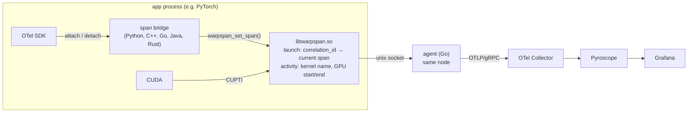

# Warpspan

GPU kernel profiling linked to OpenTelemetry traces. Warpspan records the CUDA
kernels a process runs, tags each one with the trace/span that was active on the
launching thread, and exports them as OTLP profiles (for example to Pyroscope).

It works like auto-instrumentation: no app code changes, only environment
variables set at process start.

**Docs:** https://warpspan.docs.razin.ai · **Write-up:** [GPU Time per Request](https://razin.ai/blog/gpu-time-per-request)



| Path | What |
|---|---|
| `capture/` | `libwarpspan.so`, loaded by CUDA via `CUDA_INJECTION64_PATH` (CUPTI Callback + Activity API) |
| `bridge/python/` | publishes the active OTel span to the library (Python) |
| `bridge/cpp/` | the same for OpenTelemetry C++ (header-only) |
| `bridge/go/` | the same for Go programs that launch CUDA work through cgo |
| `bridge/java/` | the same for OpenTelemetry Java (Java 22+) |
| `bridge/rust/` | the same for Rust services using `tracing` + `tracing-opentelemetry` |
| `agent/`, `cmd/warpspan/` | node agent: aggregates per process/span/kernel, exports OTLP profiles |
| `tools/profiles-dump/` | tiny OTLP profiles receiver that prints what it gets |
| `deploy/` | docker-compose backend (Collector, Pyroscope, Tempo, Grafana), Kubernetes manifests |
| `docs/` | [ADRs](docs/decisions/), [wire protocol](docs/protocol.md) |
| `docs-site/` | the docs site at warpspan.docs.razin.ai (Fumadocs, static export) |

**Status:** prototype. Linux x86_64, NVIDIA GPUs. Tested on one machine (RTX
3070, CUDA 13.4, driver 615). The build has guards for CUDA 11.6+, but older
versions have not been tried.

Verified on that machine, with the docker-compose stack (Collector 0.165,
Pyroscope 2.4.4, Tempo 2.10, Grafana 13.3):

- PyTorch example (`examples/torch-spans`): all 130 kernels of 10 requests
  were linked to the right child span (preprocess / forward / postprocess).
- In Grafana, opening the trace in Tempo, clicking a span and then "Profiles
  for this span" shows a flame graph of exactly the kernels that span ran.
- The bridge also loads under `opentelemetry-instrument`.
- The inject image's CUDA 12.6 build (with its bundled libcupti) ran the same
  PyTorch example on the GPU, copied out to the host. It hasn't run inside a
  GPU container (no NVIDIA container toolkit on the test machine).

## Build

Prebuilt files are on the [releases page](https://github.com/RazinAI/warpspan/releases):
`libwarpspan.so` for CUDA 11.8, 12.4, 12.6, 12.8 and 13.0 (with its `libcupti` and
the Python bridge), the agent binary and the Python wheel. To build from source:

Requirements: CUDA toolkit (`cupti.h`, `libcupti.so`), `g++`, `make`, Go ≥ 1.26
(an older `go` downloads 1.26 automatically).

```sh
make                                           # capture/libwarpspan.so, bin/warpspan, bin/profiles-dump
make -C capture CUDA_HOME=/usr/local/cuda-12.4  # a specific toolkit
```

Build `libwarpspan.so` against a CUDA toolkit **no newer than what the driver
supports** (`nvidia-smi`, top right, "CUDA Version"). Otherwise CUPTI fails to
start: warpspan logs `CUPTI setup failed` and the app runs unprofiled.

## Try it on a GPU machine

```sh
make

# 1. A receiver. Either print what arrives:
./bin/profiles-dump -listen 127.0.0.1:4317 &
#    or run the full backend (Docker; Grafana on localhost:3000, GRAFANA_PORT=3001 to change):
#    docker compose -f deploy/docker-compose.yaml up -d

# 2. The agent
./bin/warpspan --socket /tmp/warpspan/warpspan.sock --otlp-endpoint http://127.0.0.1:4317 &

# 3. Any CUDA program, with warpspan injected
export CUDA_INJECTION64_PATH=$PWD/capture/libwarpspan.so
export WARPSPAN_SOCKET=/tmp/warpspan/warpspan.sock
export OTEL_SERVICE_NAME=torch-spans-example
export PYTHONPATH=$PWD/bridge/python/autoload:$PWD/bridge/python/src   # Python span bridge
python examples/torch-spans/app.py --requests 50                       # needs torch + opentelemetry-sdk
```

If the app runs under `opentelemetry-instrument`, install the bridge instead of
setting `PYTHONPATH` (`pip install ./bridge/python`). `opentelemetry-instrument`
puts its own `sitecustomize` first, and that one doesn't chain to ours, so the
bridge loads through its `opentelemetry_pre_instrument` entry point instead.

For a C++ app using OpenTelemetry C++, include
`bridge/cpp/include/warpspan/otel_bridge.h` and call
`warpspan::otel::Install()` at startup, before other threads use OpenTelemetry.
It loads the library from `CUDA_INJECTION64_PATH` and does nothing (returns
false) when that's unset. Link with `-ldl` on glibc older than 2.34.

Go has no per-thread current span, so the Go bridge
(`github.com/RazinAI/warpspan/bridge/go`) wraps the cgo calls that launch GPU
work: `warpspan.Install("")` once, then `warpspan.Do(ctx, func() { C.launch(...) })`
publishes the span from `ctx` on a locked OS thread for the duration of the
call. Only launches on that thread are linked. Call `warpspan.Flush()` before
exiting: Go skips C `atexit` handlers, so the library's own exit flush doesn't
run.

For Java (22+, it uses the foreign function API), `make -C bridge/java` builds
`bridge/java/build/warpspan-otel.jar`; put it on the classpath next to
`opentelemetry-api`. Call `ai.razin.warpspan.Warpspan.install()` at
startup, after any other `ContextStorage.addWrapper` and before anything uses
OpenTelemetry; it returns false if it was too late. Run the JVM with
`--enable-native-access=ALL-UNNAMED`. Virtual threads aren't supported. Tested
with the API and SDK used directly; under the OpenTelemetry Java agent, which
manages context storage itself, `install()` may return true without the bridge
seeing any spans.

For Rust services that use `tracing` with `tracing-opentelemetry`, add the layer
from `warpspan_otel::layer()` to the subscriber after the OpenTelemetry layer
(path dependency on `bridge/rust`; the crate docs show how to skip it when
warpspan isn't in use). It publishes the span on every span enter and exit,
which includes each poll of an instrumented future. It needs the OpenTelemetry
layer's context activation (the default) and the same `opentelemetry` version
(0.33) as `tracing-opentelemetry`. Getting either wrong links nothing; the layer
prints one warning if it sees no OpenTelemetry span in its first 10,000 enters.
Work moved to `spawn_blocking`, rayon or un-instrumented tasks isn't linked.

What to look for:

- On stderr the app prints `warpspan: loaded …`, `warpspan: connected to agent …`,
  and at exit `warpspan: exiting: N kernels, M linked to spans, …`. If M is 0
  while the app creates spans, the bridge isn't loaded.
- The agent logs one `interval` line per export with `kernels=` and `linked_to_spans=`.
- `profiles-dump` prints samples such as `[812345]  cuda:0 > at::native::… [trace=… span=…]`.
  The trace/span IDs match the ones the example app prints.
- In Pyroscope or Grafana: profile type `gpu` → `gpu_time`, service
  `torch-spans-example`. A freshly started Pyroscope can take about a minute
  before data becomes queryable.
- In Grafana's trace view, spans have a "Profiles for this span" button. Grafana
  shows it only for spans with the `pyroscope.profile.id` attribute, which the
  bridge sets (to the span ID) on every span that becomes current.

Without any agent, `WARPSPAN_DEBUG_FILE=/tmp/kernels.log` (`-` for stderr)
writes one line per kernel, including trace/span IDs.

## Kubernetes

The agent runs as a DaemonSet on GPU nodes, installed with the Helm chart in
[`deploy/helm/warpspan`](deploy/helm/warpspan/) (published to
`oci://ghcr.io/razinai/charts/warpspan` by CI on every version bump):

```sh
helm install warpspan oci://ghcr.io/razinai/charts/warpspan \
  --namespace warpspan --create-namespace \
  --set otlp.endpoint=http://otel-collector.observability.svc:4317
```

GPU pods still need the init container, volumes and environment variables added
by hand; `helm install` prints them, and
[`deploy/kubernetes/example-gpu-pod.yaml`](deploy/kubernetes/example-gpu-pod.yaml)
shows them in full. A mutating webhook that would add them doesn't exist yet.
`hostPath` volumes are rejected by the `baseline`/`restricted` Pod Security levels.

Without Helm, `helm template` renders the same manifests for `kubectl apply`.

CI builds the images too: `ghcr.io/razinai/warpspan-agent:<version>` and
`ghcr.io/razinai/warpspan-inject:<version>-cuda<11.8|12.4|12.6|12.8|13.0>` (plain
`<version>` is CUDA 12.6). The chart's `appVersion`, the agent's `version` and the
Python package version must match; CI checks.

## Configuration

Capture library (environment of the app process, read once at CUDA initialisation):

| Variable | Default | |
|---|---|---|
| `CUDA_INJECTION64_PATH` | (none) | path to `libwarpspan.so`; enables warpspan |
| `WARPSPAN_SOCKET` | `/var/run/warpspan/warpspan.sock` | agent socket; empty = don't send |
| `WARPSPAN_DEBUG_FILE` | (none) | write kernel records as text (`-` = stderr) |
| `WARPSPAN_QUIET` | | `1` = no log lines on stderr |
| `WARPSPAN_DISABLE` | | `1` = load but do nothing |
| `OTEL_SERVICE_NAME`, `OTEL_RESOURCE_ATTRIBUTES` | | used for `service.name` and resource attributes |

Agent: `./bin/warpspan -h`. The flags are `--socket`, `--otlp-endpoint`
(`http://host:port` is plaintext, `https://host:port` or `host:port` uses TLS,
`none` disables export), `--otlp-header k=v`, `--interval`, `--node-name`.
It also reads `OTEL_EXPORTER_OTLP_ENDPOINT` and `OTEL_EXPORTER_OTLP_HEADERS`.

OTLP profiles are alpha: the Collector needs `--feature-gates=service.profilesSupport`.
Tested with Collector 0.165.0 and Pyroscope 2.4.4.

## Limitations

- Only kernels: no memcpy/memset, no CPU or Python stacks.
- Span linking works per thread and needs a span bridge (Python, C++, Go, Java
  and Rust so far). Kernels launched from threads the span doesn't reach (e.g.
  PyTorch's autograd backward) are unlinked. In Python before 3.14, asyncio
  tasks and thread pools running a copied context switch spans without telling
  the bridge, so their kernels can get the span last attached on that thread.
  3.14+ handles both in the main interpreter (context watchers); not in
  sub-interpreters, and not with gevent/greenlet. See ADR 0002.
- Records are dropped rather than slowing the app: on CUPTI buffer overflow and
  when the agent is busy. If more than 131k launches happen between flushes, the
  oldest are still counted but lose their span.
- CUPTI allows one subscriber per process. Nsight Systems or `torch.profiler`
  may fail to attach while warpspan is active; use `WARPSPAN_DISABLE=1` for those runs.
- A process that `fork()`s after CUDA initialisation isn't profiled in the child.
- The agent socket is world-writable; see the trust model in `docs/protocol.md`.

## Tests

```sh
make test
```

This builds `libwarpspan.so`, then runs the Go tests (agent and Go bridge) and
the Python bridge tests, which need `pip install opentelemetry-sdk pytest`. It
needs the CUDA toolkit for the build, but no GPU.

The other bridges' tests run when their tools are there, and are skipped
otherwise:

- **C++:** `OTEL_CPP` points at the opentelemetry-cpp sources.
- **Java:** `MAVEN_JARS` holds the OpenTelemetry jars (see `bridge/java/Makefile`).
- **Rust:** `cargo` is installed.

The Python 3.14 context-watcher tests run only on Python 3.14 or newer; older
versions skip them. To run them, pick the interpreter:

```sh
make test PYTHON=python3.14
```

## License

[PolyForm Strict 1.0.0](LICENSE). You may use Warpspan for noncommercial purposes
(personal use, research, education, noncommercial organizations). You may not
distribute it or make changes or new works based on it. For commercial use or
other terms, contact hello@razin.ai.
