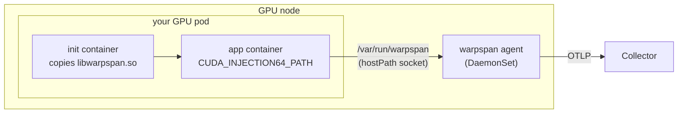

`deploy/kubernetes/` has the manual setup. A mutating webhook and a Helm chart that would do this for you don't exist yet.



<Steps>
<Step>

### Build and push the images

```sh
docker build -f agent/Dockerfile -t <registry>/warpspan-agent:0.1.0 .
docker build -f capture/Dockerfile \
  --build-arg CUDA_IMAGE=nvidia/cuda:<your CUDA>-devel-ubuntu20.04 \
  -t <registry>/warpspan-inject:0.1.0 .
```

The inject image builds `libwarpspan.so` against the CUDA version you pass, bundles the matching `libcupti`, and adds the Python bridge. Pick a CUDA version no newer than your nodes' driver supports.

</Step>
<Step>

### Run the agent on GPU nodes

Edit the image and `--otlp-endpoint` in `agent-daemonset.yaml`, then apply it. It runs on nodes labelled `nvidia.com/gpu.present`, creates the socket in the host directory `/var/run/warpspan`, and adds `k8s.node.name` to every profile.

```sh
kubectl apply -f deploy/kubernetes/agent-daemonset.yaml
```

</Step>
<Step>

### Add Warpspan to a GPU workload

From `example-gpu-pod.yaml`, add to your pod:

- the `warpspan-init` init container, which copies the library into an `emptyDir` volume mounted at `/warpspan`;
- the `hostPath` volume for `/var/run/warpspan`, mounted read-only into the app container;
- these environment variables on the app container:

```yaml
- name: CUDA_INJECTION64_PATH
  value: /warpspan/libwarpspan.so
- name: WARPSPAN_SOCKET
  value: /var/run/warpspan/warpspan.sock
- name: PYTHONPATH        # Python apps; prepend if the image already sets it
  value: /warpspan/python
- name: OTEL_SERVICE_NAME
  value: your-service
```

</Step>
</Steps>

`hostPath` volumes are rejected by the `baseline` and `restricted` Pod Security levels, so the namespace needs `privileged` for now.

The inject image has been checked loading its bundled `libcupti` inside a plain CUDA runtime image, and its build ran the PyTorch example on a GPU outside a container. It hasn't run inside a GPU container yet.
