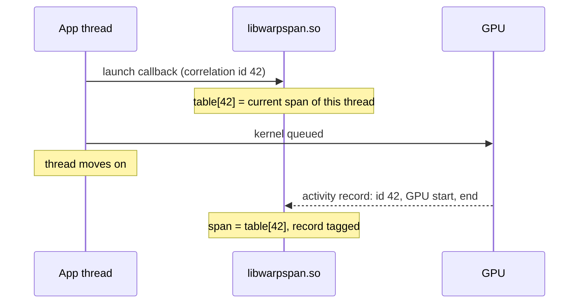

The hard part of linking GPU work to requests is timing. A CUDA kernel runs after the CPU thread that launched it has moved on, sometimes to another request. So Warpspan has to remember the span **at launch** and attach it to the kernel **when the GPU reports it finished**.

## Getting into the process

Every CUDA program, in any language, goes through NVIDIA's driver library. When `CUDA_INJECTION64_PATH` is set, the driver loads that library during CUDA initialisation and calls its `InitializeInjection()` function. NVIDIA's own tools use the same mechanism. That's why no code change is needed: the variable is enough.

`InitializeInjection` reads its settings, subscribes to CUPTI and starts one background thread. If anything fails it logs why and returns, and the app runs as if Warpspan weren't there.

## The join

CUPTI gives Warpspan two views of the same kernel, connected by a **correlation ID**.

1. **At launch**, on the app's own thread, the CUPTI callback for `cudaLaunchKernel` (and the driver, cooperative and graph launch variants) stores *correlation ID to current span* in a table.
2. **When the kernel finishes**, CUPTI hands over an activity record with the kernel name, the GPU start and end time and the same correlation ID. The library looks the span up and tags the record.

The table has 131,072 slots indexed by the correlation ID, and each slot is a small seqlock. Writing at launch is a few relaxed atomic stores, with no lock and no allocation. If more launches than that happen between two flushes, the oldest slots are reused and those kernels are counted without a span.

Kernels inside a CUDA graph share the graph launch's correlation ID, so they get the span that was active at `cudaGraphLaunch`.

## Knowing the current span

The library keeps one "current span" per thread, set through an exported C function, `warpspan_set_span(trace_id, span_id)`. A [span bridge](/docs/bridges) calls it whenever the current span on that thread changes. The Python bridge, for example, wraps OpenTelemetry's context attach and detach, so every `start_as_current_span` updates it.

Only sampled, local spans are published. An unsampled span never reaches the trace backend and a remote parent belongs to another service, so linking kernels to them would only add IDs nobody can look up.

Each bridge also sets the span attribute `pyroscope.profile.id` to the span ID, once per span. Grafana shows "Profiles for this span" only on spans that have it.

## Getting the data out

The library batches tagged records and sends them about once a second over a unix `SOCK_SEQPACKET` socket to the agent on the same node. Sends never block: if the agent is busy, the batch is dropped and counted. At exit the library does one last forced flush, so short processes are recorded too.

The agent keeps one connection per process. Every interval (10 seconds by default) it sums GPU time and launch counts per process, kernel, device and span, and exports one OTLP profiles request per process to the Collector over gRPC. See [Wire protocol](/docs/reference/wire-protocol) for the socket format.

## The profile

Per process there are two profiles, `gpu_time` in nanoseconds and `kernel_launches` as a count, both with period type `gpu`, which is why Pyroscope names them `gpu`. Each sample's stack is two frames, `cuda:<device>` and the kernel name. The launching span goes into the sample's link, which Pyroscope turns into `span_id` and `trace_id` labels.

Kernel names arrive mangled. The agent demangles them and shortens long template names: namespaces inside template arguments are dropped, lambdas become `{lambda}`, and if the name is still over 160 characters the deepest template arguments become `<…>`. PyTorch's GELU kernel, for example, becomes `at::native::vectorized_elementwise_kernel<4, GeluCUDAKernelImpl::{lambda}, array<char*, 2ul>, false>`.

`service.name` follows the usual OpenTelemetry rules, from the process's own `OTEL_SERVICE_NAME` or `OTEL_RESOURCE_ATTRIBUTES`, so profiles and traces land under the same service.

## Why these choices

The full reasoning is in the repo's decision records: [0001](https://github.com/zraisan/warpspan/blob/master/docs/decisions/0001-architecture.md) for the architecture and [0002](https://github.com/zraisan/warpspan/blob/master/docs/decisions/0002-span-bridge-and-transport.md) for the bridges, the transport and the profile shape.
