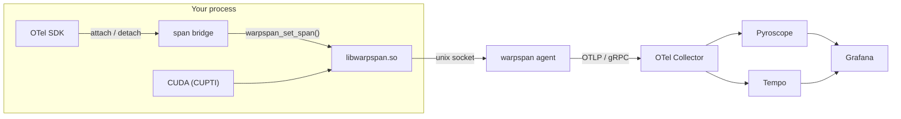

Warpspan records the CUDA kernels a process runs, tags each one with the OpenTelemetry span that was active on the thread that launched it, and exports them as OTLP profiles. In Grafana that means you can open a trace in Tempo, click a span, and see a flame graph of the GPU kernels that span ran.

It works like auto-instrumentation. You don't change the app's code: you set environment variables when the process starts.

## What you see

Take a request handler with three child spans: `preprocess`, `forward` and `postprocess`. With Warpspan, clicking `forward` in the trace view shows only the kernels it launched, for example `ampere_sgemm` and the GELU kernel, with their GPU time. Clicking `preprocess` shows its random-number and reduction kernels instead.

Under the hood Pyroscope stores two profile types per process:

| Profile type | What a sample's value is |
| --- | --- |
| `gpu:gpu_time:nanoseconds:gpu:nanoseconds` | GPU time of that kernel, summed over the interval |
| `gpu:kernel_launches:count:gpu:nanoseconds` | how many times it ran |

Each sample's stack is `cuda:<device>` then the kernel name, and it carries the trace and span IDs of the span that launched it.

## The pieces

- **Capture library** (`libwarpspan.so`): CUDA loads it into the process when `CUDA_INJECTION64_PATH` points at it. It uses NVIDIA's CUPTI to see every kernel launch and every finished kernel.
- **Span bridge**: a small piece per language that tells the library which span is current on each thread. Python, C++, Go, Java and Rust have one.
- **Agent**: one Go process per node. It receives kernel records from every process on the node, sums them per process, span and kernel, and exports OTLP profiles.
- **Backend**: an OpenTelemetry Collector with profiles enabled, Pyroscope for the profiles, Tempo for the traces and Grafana to look at both. The repo has a docker-compose file for all four.

## Status

Warpspan is a prototype. It runs on Linux x86_64 with NVIDIA GPUs and has been tested end to end on one machine: an RTX 3070 laptop GPU, CUDA 13.4, driver 615, with Collector 0.165, Pyroscope 2.4.4, Tempo 2.10 and Grafana 13.3. On that machine the PyTorch example linked all 130 kernels of 10 requests to the right child span, and Grafana's "Profiles for this span" showed exactly the kernels each span ran.

The build has guards for CUDA 11.6 and newer, but versions other than 12.6 and 13.4 haven't been run. OTLP profiles are an alpha signal in OpenTelemetry, so the Collector and Pyroscope versions are pinned together.

Read [Quickstart](/docs/quickstart) to run it, or [How it works](/docs/how-it-works) for the details.
