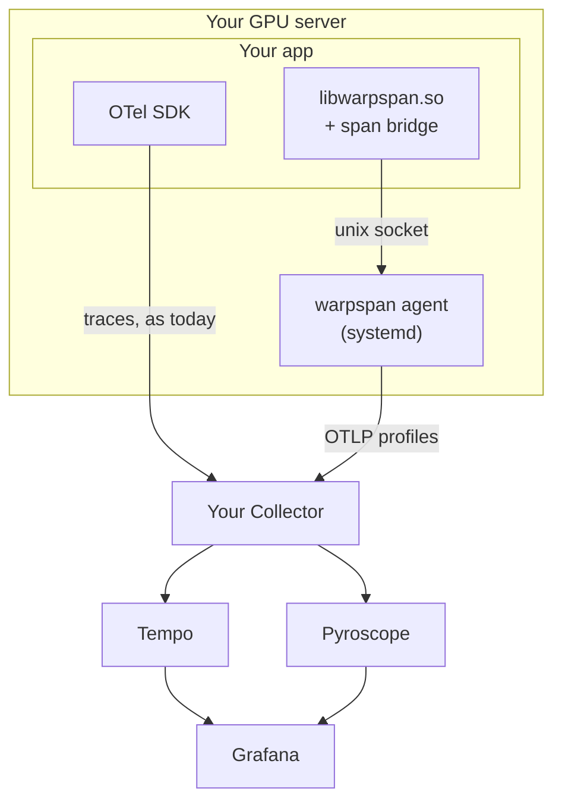

This page is for a GPU server you already run: a Linux machine (bare metal or a VM) with an app that has OpenTelemetry tracing and sends its traces somewhere. For Kubernetes, see [Kubernetes](/docs/deploy/kubernetes); the steps for the app and for Grafana are the same.

Nothing about your traces changes. The app's OpenTelemetry SDK keeps exporting them as before. Warpspan adds three things on the machine: a library inside the app process, a span bridge that tells it the current span, and an agent that sends GPU profiles to your Collector.



## What you need

- Linux x86_64 with an NVIDIA GPU and driver. `nvidia-smi` shows the newest CUDA version the driver supports, at the top right.
- glibc 2.31 or newer (Ubuntu 20.04, Debian 11, RHEL 9 and later). The CUDA 13.0 build needs 2.35 (Ubuntu 22.04).
- An app that uses OpenTelemetry in Python, C++, Go, Java or Rust. Other CUDA programs work too, but their kernels are recorded without spans.
- A place for the profiles. Profiles are a separate signal from traces: they go to [Pyroscope](https://grafana.com/oss/pyroscope/), and Grafana links them to the spans in Tempo. Warpspan has been tested with Collector 0.165 and Pyroscope 2.4.4.

<Steps>
<Step>

### Download

Take the files from the [latest release](https://github.com/RazinAI/warpspan/releases/latest). Pick the CUDA build that is no newer than what `nvidia-smi` shows: 11.8, 12.4, 12.6, 12.8 or 13.0. For a driver that shows 12.8, take 12.8.

```sh
V=0.1.0
CUDA=12.6
base=https://github.com/RazinAI/warpspan/releases/download/v$V
curl -fsSLO $base/warpspan-$V-cuda$CUDA-linux-x86_64.tar.gz
curl -fsSLO $base/warpspan-agent-$V-linux-amd64
curl -fsSLO $base/SHA256SUMS
sha256sum -c SHA256SUMS --ignore-missing

sudo mkdir -p /opt/warpspan
sudo tar -xzf warpspan-$V-cuda$CUDA-linux-x86_64.tar.gz -C /opt/warpspan
sudo ln -sfn warpspan-$V-cuda$CUDA /opt/warpspan/lib
sudo install -m 0755 warpspan-agent-$V-linux-amd64 \
  /opt/warpspan/warpspan-agent
```

`/opt/warpspan/lib` now has `libwarpspan.so`, the `libcupti` it was built against, and the Python bridge in `python/`. The `lib` symlink lets you upgrade later by pointing it at a new version.

</Step>
<Step>

### Run the agent

One agent per machine serves every GPU process on it. As a systemd service, in `/etc/systemd/system/warpspan-agent.service`:

```ini
[Unit]
Description=Warpspan agent
Wants=network-online.target
After=network-online.target

[Service]
ExecStart=/opt/warpspan/warpspan-agent --otlp-endpoint http://127.0.0.1:4317
DynamicUser=yes
RuntimeDirectory=warpspan
RuntimeDirectoryMode=0755
RuntimeDirectoryPreserve=yes
Restart=on-failure

[Install]
WantedBy=multi-user.target
```

```sh
sudo systemctl daemon-reload
sudo systemctl enable --now warpspan-agent
journalctl -u warpspan-agent -f
```

The agent listens on `/run/warpspan/warpspan.sock`, the default path the library looks for, so apps on the machine need no extra setting to find it. It doesn't need root. `RuntimeDirectoryPreserve` keeps the directory when the agent restarts, so containers that mount it keep working.

Set `--otlp-endpoint` to where the profiles should go (next step). For a Collector that needs authentication, add `--otlp-header` flags or set `OTEL_EXPORTER_OTLP_HEADERS`. `https://` turns on TLS. See [Configuration](/docs/reference/configuration) for all flags.

The agent also runs as a container, if you prefer:

```sh
docker run -d --name warpspan-agent \
  --restart unless-stopped --network host \
  -v /run/warpspan:/var/run/warpspan \
  ghcr.io/razinai/warpspan-agent:$V \
  --otlp-endpoint http://127.0.0.1:4317
```

</Step>
<Step>

### Send the profiles to your backend

<Tabs items={['Through your Collector', 'Straight to Pyroscope']}>
<Tab value="Through your Collector">

The agent sends to the Collector's normal OTLP gRPC receiver (port 4317), the same one your traces use. Profiles are an alpha signal, so the Collector needs two changes:

1. Start it with the feature gate `--feature-gates=service.profilesSupport`.
2. Add a `profiles` pipeline next to your existing ones, with an exporter to Pyroscope:

```yaml
exporters:
  otlp_grpc/pyroscope:
    endpoint: pyroscope.internal:4040
    tls:
      insecure: true   # remove if Pyroscope has TLS

service:
  pipelines:
    traces:
      # unchanged
    profiles:
      receivers: [otlp]
      exporters: [otlp_grpc/pyroscope]
```

The exporter name is `otlp_grpc` in Collector 0.165; older versions call it `otlp`. Upgrade the Collector and Pyroscope together, since the profiles format still changes between releases.

</Tab>
<Tab value="Straight to Pyroscope">

Without a Collector, point the agent at Pyroscope, which accepts OTLP profiles on its HTTP port:

```sh
--otlp-endpoint http://pyroscope.internal:4040
```

The tested path is through a Collector; this skips the Collector's batching and retries.

</Tab>
</Tabs>

</Step>
<Step>

### Add Warpspan to the app

The app needs three environment variables, set wherever it starts:

- `CUDA_INJECTION64_PATH=/opt/warpspan/lib/libwarpspan.so`: CUDA loads the library into the process. This is what turns Warpspan on.
- `OTEL_SERVICE_NAME`: the same name your traces use. Grafana matches spans to profiles by service name.
- `PYTHONPATH=/opt/warpspan/lib/python`, for Python apps: loads the Python span bridge.

<Callout title="Use the same service name as your traces">
The library reads the service name only from `OTEL_SERVICE_NAME` (or `service.name` in `OTEL_RESOURCE_ATTRIBUTES`). If your app sets its service name in code, set the variable to the same value anyway, or Grafana won't find the profiles for its spans.
</Callout>

<Tabs items={['systemd', 'Docker', 'Docker Compose']}>
<Tab value="systemd">

Add a drop-in with `sudo systemctl edit my-app`:

```ini
[Service]
Environment=CUDA_INJECTION64_PATH=/opt/warpspan/lib/libwarpspan.so
Environment=OTEL_SERVICE_NAME=my-app
Environment=PYTHONPATH=/opt/warpspan/lib/python
```

If the unit already sets `PYTHONPATH`, put `/opt/warpspan/lib/python` first in it. Then `sudo systemctl restart my-app`.

</Tab>
<Tab value="Docker">

Mount the library and the agent's socket directory into the container:

```sh
docker run --gpus all \
  -v /opt/warpspan/lib:/opt/warpspan:ro \
  -v /run/warpspan:/var/run/warpspan:ro \
  -e CUDA_INJECTION64_PATH=/opt/warpspan/libwarpspan.so \
  -e PYTHONPATH=/opt/warpspan/python \
  -e OTEL_SERVICE_NAME=my-app \
  my-app:latest
```

The glibc that counts is the one in the app's image, not the host's.

</Tab>
<Tab value="Docker Compose">

```yaml
services:
  my-app:
    image: my-app:latest
    volumes:
      - /opt/warpspan/lib:/opt/warpspan:ro
      - /run/warpspan:/var/run/warpspan:ro
    environment:
      CUDA_INJECTION64_PATH: /opt/warpspan/libwarpspan.so
      PYTHONPATH: /opt/warpspan/python
      OTEL_SERVICE_NAME: my-app
    deploy:
      resources:
        reservations:
          devices:
            - driver: nvidia
              count: all
              capabilities: [gpu]
```

The glibc that counts is the one in the app's image, not the host's.

</Tab>
</Tabs>

**Other languages** load their bridge differently. The library and the variables above stay the same:

- **Python under `opentelemetry-instrument`:** `pip install` the wheel from the release instead of setting `PYTHONPATH` ([why](/docs/bridges/python)).
- **[C++](/docs/bridges/cpp):** include `warpspan/otel_bridge.h` and call `warpspan::otel::Install()` at startup.
- **[Go](/docs/bridges/go):** `go get github.com/RazinAI/warpspan/bridge/go@latest`, wrap GPU calls in `warpspan.Do(ctx, fn)`, and call `warpspan.Flush()` before exit.
- **[Java](/docs/bridges/java):** call `Warpspan.install()` at startup. Needs Java 22 or newer.
- **[Rust](/docs/bridges/rust):** add `WarpspanLayer` to the subscriber, after `tracing-opentelemetry`.

</Step>
<Step>

### Link spans to profiles in Grafana

In Grafana, under **Connections → Data sources**:

1. Add a **Grafana Pyroscope** data source pointing at your Pyroscope, if you don't have one.
2. Open your **Tempo** data source and find **Trace to profiles**:
   - Data source: the Pyroscope data source.
   - Tags: `service.name` as `service_name`.
   - Profile type: `gpu` → `gpu_time`.
3. Save.

Open a trace from the app, click a span, and **Profiles for this span** shows the GPU kernels that span launched, with their GPU time. The button only appears on spans that carry the `pyroscope.profile.id` attribute, which the bridges add.

</Step>
</Steps>

## Check that it works

1. Restart the app and look at its stderr (`journalctl -u my-app` or `docker logs`). You should see `warpspan: loaded …` and `warpspan: connected to agent …`.
2. The agent logs a line per export with `kernels=` and `linked_to_spans=`.
3. In Grafana's Explore, pick the Pyroscope data source, profile type `gpu_time` and your service. A new Pyroscope can take a minute before data shows.
4. At app exit the library prints `N kernels, M linked to spans`. If M is 0 while the app makes spans, the bridge didn't load: see [Troubleshooting](/docs/troubleshooting).

## Things to know

- **Sampling:** only kernels launched under a sampled span are linked to it. With traces sampled at 1%, the other 99% of kernels are still counted in the service's flame graph, just without a span.
- **Other profilers:** CUPTI allows one profiler per process. For a run under Nsight Systems or `torch.profiler`, set `WARPSPAN_DISABLE=1`.
- **Turning it off:** remove `CUDA_INJECTION64_PATH` and restart the app. Nothing else in the app depends on Warpspan.
- **Who can send to the agent:** any process on the machine can connect to the socket. See [Limitations](/docs/limitations) for this and other known gaps.
