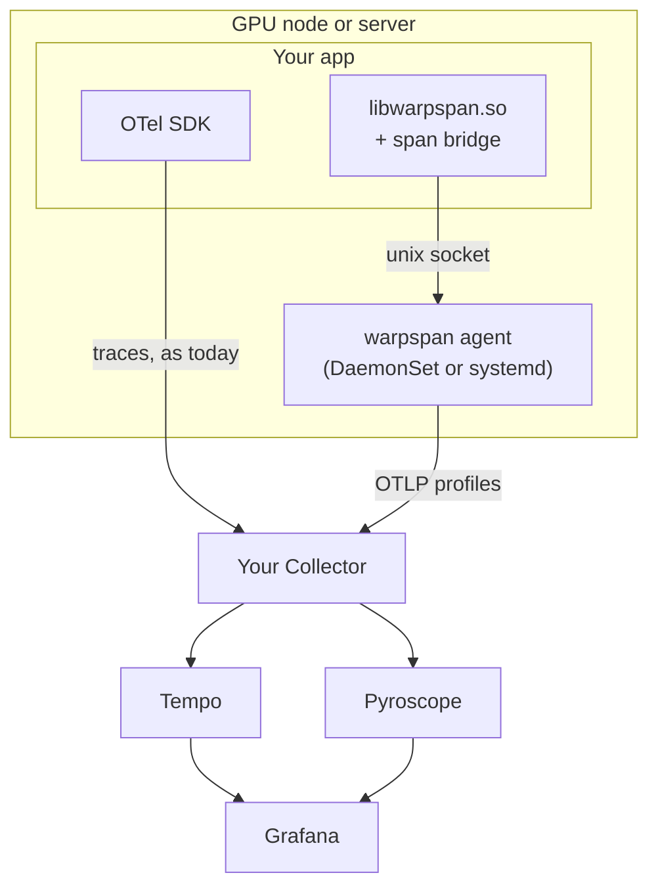

This page is for an app you already run: it has OpenTelemetry tracing and sends its traces somewhere. Each step has two tabs. **Kubernetes** installs with Helm; **Linux server** is for a bare-metal machine or VM with systemd or Docker. Pick one and every step follows it.

Nothing about your traces changes. The app's OpenTelemetry SDK keeps exporting them as before. Warpspan adds three things: a library inside the app process, a span bridge that tells it the current span, and an agent on each GPU machine that sends GPU profiles to your Collector.



## What you need

- Linux x86_64 with an NVIDIA GPU and driver. `nvidia-smi` shows the newest CUDA version the driver supports, at the top right.
- glibc 2.31 or newer where the app runs (Ubuntu 20.04, Debian 11, RHEL 9 and later). The CUDA 13.0 build needs 2.35 (Ubuntu 22.04). In a container, the app image's glibc is the one that counts.
- An app that uses OpenTelemetry in Python, C++, Go, Java or Rust. Other CUDA programs work too, but their kernels are recorded without spans.
- A place for the profiles. Profiles are a separate signal from traces: they go to [Pyroscope](https://grafana.com/oss/pyroscope/), and Grafana links them to the spans in Tempo. Warpspan has been tested with Collector 0.165 and Pyroscope 2.4.4.
- On Kubernetes: Helm 3.8 or newer, and GPU nodes labelled `nvidia.com/gpu.present=true`, which NVIDIA's GPU operator and device plugin do.

<Steps>
<Step>

### Install the agent

One agent per machine serves every GPU process on it.

<Tabs groupId="platform" persist items={['Kubernetes', 'Linux server']}>
<Tab value="Kubernetes">

The chart runs the agent as a DaemonSet on GPU nodes. Point it at your Collector's OTLP gRPC port (next step):

```sh
helm install warpspan oci://ghcr.io/razinai/charts/warpspan \
  --namespace warpspan --create-namespace \
  --set otlp.endpoint=http://otel-collector.observability.svc:4317
```

Check that there is one agent per GPU node:

```sh
kubectl -n warpspan get pods -o wide
kubectl -n warpspan logs -l app.kubernetes.io/name=warpspan
```

No pods means no node matched. See the labels with `kubectl get nodes -L nvidia.com/gpu.present`, and change `nodeSelector` in the values if your GPU nodes use another label. The agent puts its socket in the host directory `/var/run/warpspan`, and app pods mount the same directory in step 3.

For a Collector that needs authentication, set `otlp.headers` or `otlp.headersFromSecret`. [Kubernetes](/docs/deploy/kubernetes) lists every value.

</Tab>
<Tab value="Linux server">

Take the files from the [latest release](https://github.com/RazinAI/warpspan/releases/latest). Pick the CUDA build that is no newer than what `nvidia-smi` shows: 11.8, 12.4, 12.6, 12.8 or 13.0. For a driver that shows 12.8, take 12.8.

```sh
V=0.1.0
CUDA=12.6
base=https://github.com/RazinAI/warpspan/releases/download/v$V
curl -fsSLO $base/warpspan-$V-cuda$CUDA-linux-x86_64.tar.gz
curl -fsSLO $base/warpspan-agent-$V-linux-amd64
curl -fsSLO $base/SHA256SUMS
sha256sum -c SHA256SUMS --ignore-missing

sudo mkdir -p /opt/warpspan
sudo tar -xzf warpspan-$V-cuda$CUDA-linux-x86_64.tar.gz -C /opt/warpspan
sudo ln -sfn warpspan-$V-cuda$CUDA /opt/warpspan/lib
sudo install -m 0755 warpspan-agent-$V-linux-amd64 \
  /opt/warpspan/warpspan-agent
```

`/opt/warpspan/lib` now has `libwarpspan.so`, the `libcupti` it was built against, and the Python bridge in `python/`. The `lib` symlink lets you upgrade later by pointing it at a new version.

Run the agent as a systemd service, in `/etc/systemd/system/warpspan-agent.service`:

```ini
[Unit]
Description=Warpspan agent
Wants=network-online.target
After=network-online.target

[Service]
ExecStart=/opt/warpspan/warpspan-agent --otlp-endpoint http://127.0.0.1:4317
DynamicUser=yes
RuntimeDirectory=warpspan
RuntimeDirectoryMode=0755
RuntimeDirectoryPreserve=yes
Restart=on-failure

[Install]
WantedBy=multi-user.target
```

```sh
sudo systemctl daemon-reload
sudo systemctl enable --now warpspan-agent
journalctl -u warpspan-agent -f
```

The agent listens on `/run/warpspan/warpspan.sock`, the default path the library looks for, so apps on the machine need no extra setting to find it. It doesn't need root. `RuntimeDirectoryPreserve` keeps the directory when the agent restarts, so containers that mount it keep working.

Set `--otlp-endpoint` to where the profiles should go (next step). For a Collector that needs authentication, add `--otlp-header` flags or set `OTEL_EXPORTER_OTLP_HEADERS`. `https://` turns on TLS. See [Configuration](/docs/reference/configuration) for all flags.

The agent also runs as a container, if you prefer:

```sh
docker run -d --name warpspan-agent \
  --restart unless-stopped --network host \
  -v /run/warpspan:/var/run/warpspan \
  ghcr.io/razinai/warpspan-agent:$V \
  --otlp-endpoint http://127.0.0.1:4317
```

</Tab>
</Tabs>

</Step>
<Step>

### Send the profiles to your backend

The agent sends to the Collector's normal OTLP gRPC receiver (port 4317), the same one your traces use. Profiles are an alpha signal, so the Collector needs two changes: the feature gate `service.profilesSupport`, and a `profiles` pipeline with an exporter to Pyroscope.

<Tabs groupId="platform" persist items={['Kubernetes', 'Linux server']}>
<Tab value="Kubernetes">

With the [official Collector chart](https://github.com/open-telemetry/opentelemetry-helm-charts/tree/main/charts/opentelemetry-collector), add this to its values. The chart merges it with your existing config, so the other pipelines stay as they are:

```yaml
command:
  extraArgs: [--feature-gates=service.profilesSupport]
config:
  exporters:
    otlp_grpc/pyroscope:
      endpoint: pyroscope.observability.svc:4040
      tls:
        insecure: true   # remove if Pyroscope has TLS
  service:
    pipelines:
      profiles:
        receivers: [otlp]
        exporters: [otlp_grpc/pyroscope]
```

```sh
helm upgrade otel-collector open-telemetry/opentelemetry-collector \
  -n observability --reuse-values -f profiles.yaml
```

With the OpenTelemetry Operator instead, add `feature-gates: service.profilesSupport` under `spec.args` of the `OpenTelemetryCollector` and the same exporter and pipeline under `spec.config`.

</Tab>
<Tab value="Linux server">

Start the Collector with `--feature-gates=service.profilesSupport` and add to its config:

```yaml
exporters:
  otlp_grpc/pyroscope:
    endpoint: pyroscope.internal:4040
    tls:
      insecure: true   # remove if Pyroscope has TLS

service:
  pipelines:
    traces:
      # unchanged
    profiles:
      receivers: [otlp]
      exporters: [otlp_grpc/pyroscope]
```

</Tab>
</Tabs>

Pyroscope's default ingestion limit (4 MiB/s per tenant, 2 MiB burst) is low for a busy GPU service with spans and NVTX labels, and Pyroscope drops a whole push above it: the Collector then logs `push rate limit (4.0 MiB) exceeded`. Raise it with `-distributor.ingestion-rate-limit-mb` and `-distributor.ingestion-burst-size-mb` (or `ingestion_rate_mb` / `ingestion_burst_size_mb` in its limits config).

The exporter name is `otlp_grpc` in Collector 0.165; older versions call it `otlp`. Upgrade the Collector and Pyroscope together, since the profiles format still changes between releases.

Without a Collector, the agent can send straight to Pyroscope, which accepts OTLP profiles on its HTTP port: use Pyroscope's address, such as `http://pyroscope:4040`, as the endpoint. That path skips the Collector's batching and retries and is less tested.

</Step>
<Step>

### Add Warpspan to the app

The app needs the library loaded and three environment variables:

- `CUDA_INJECTION64_PATH`: the path of `libwarpspan.so`. CUDA loads the library into the process. This is what turns Warpspan on.
- `OTEL_SERVICE_NAME`: the same name your traces use. Grafana matches spans to profiles by service name.
- `PYTHONPATH`, for Python apps: the Python span bridge's directory. If the app already sets `PYTHONPATH`, put the bridge first in it.
- Optional, `NVTX_INJECTION64_PATH`, set to the same path as `CUDA_INJECTION64_PATH`: records the app's [NVTX ranges](/docs/nvtx), and those of TensorRT, PyTorch and other libraries, as frames above each kernel.

<Callout title="Use the same service name as your traces">
The library reads the service name only from `OTEL_SERVICE_NAME` (or `service.name` in `OTEL_RESOURCE_ATTRIBUTES`). If your app sets its service name in code, set the variable to the same value anyway, or Grafana won't find the profiles for its spans.
</Callout>

<Tabs groupId="platform" persist items={['Kubernetes', 'Linux server']}>
<Tab value="Kubernetes">

The chart doesn't change your pods yet, so the GPU workload gets these additions to its pod template:

- an init container from the `warpspan-inject` image, which copies the library and the Python bridge into an `emptyDir`;
- the agent's socket directory from the node, as a read-only `hostPath`;
- the environment variables, plus `WARPSPAN_SOCKET` for where the socket is mounted.

Save this as `warpspan-patch.yaml`. Change `my-app` to your container's name and your service name, and pick the inject tag for your CUDA version (`0.1.0-cuda11.8`, `-cuda12.4`, `-cuda12.6`, `-cuda12.8` or `-cuda13.0`):

```yaml
spec:
  template:
    spec:
      initContainers:
        - name: warpspan-init
          image: ghcr.io/razinai/warpspan-inject:0.1.0-cuda12.6
          volumeMounts:
            - name: warpspan
              mountPath: /target
      containers:
        - name: my-app   # must match your container's name
          env:
            - name: CUDA_INJECTION64_PATH
              value: /warpspan/libwarpspan.so
            - name: WARPSPAN_SOCKET
              value: /var/run/warpspan/warpspan.sock
            - name: PYTHONPATH
              value: /warpspan/python
            - name: OTEL_SERVICE_NAME
              value: my-app
          volumeMounts:
            - name: warpspan
              mountPath: /warpspan
              readOnly: true
            - name: warpspan-run
              mountPath: /var/run/warpspan
              readOnly: true
      volumes:
        - name: warpspan
          emptyDir: {}
        - name: warpspan-run
          hostPath:
            path: /var/run/warpspan
            type: DirectoryOrCreate
```

Apply it to the Deployment (or StatefulSet). Kubernetes merges it into the pod template by name and rolls the pods:

```sh
kubectl -n my-namespace patch deployment my-app \
  --patch-file warpspan-patch.yaml
```

If the app is deployed by Helm, Argo CD or Flux, a `kubectl patch` is undone on the next sync. Put the same fields in the app's own manifests instead: most charts take them as `initContainers`, `extraEnv`, `extraVolumes` and `extraVolumeMounts` values.

`hostPath` volumes are rejected by the `baseline` and `restricted` [Pod Security](https://kubernetes.io/docs/concepts/security/pod-security-standards/) levels. If the app's namespace enforces one of them, it needs `privileged` for now. The `warpspan` namespace needs the same.

</Tab>
<Tab value="Linux server">

<Tabs items={['systemd', 'Docker', 'Docker Compose']}>
<Tab value="systemd">

Add a drop-in with `sudo systemctl edit my-app`:

```ini
[Service]
Environment=CUDA_INJECTION64_PATH=/opt/warpspan/lib/libwarpspan.so
Environment=OTEL_SERVICE_NAME=my-app
Environment=PYTHONPATH=/opt/warpspan/lib/python
```

Then `sudo systemctl restart my-app`.

</Tab>
<Tab value="Docker">

Mount the library and the agent's socket directory into the container:

```sh
docker run --gpus all \
  -v /opt/warpspan/lib:/opt/warpspan:ro \
  -v /run/warpspan:/var/run/warpspan:ro \
  -e CUDA_INJECTION64_PATH=/opt/warpspan/libwarpspan.so \
  -e WARPSPAN_SOCKET=/var/run/warpspan/warpspan.sock \
  -e PYTHONPATH=/opt/warpspan/python \
  -e OTEL_SERVICE_NAME=my-app \
  my-app:latest
```

</Tab>
<Tab value="Docker Compose">

```yaml
services:
  my-app:
    image: my-app:latest
    volumes:
      - /opt/warpspan/lib:/opt/warpspan:ro
      - /run/warpspan:/var/run/warpspan:ro
    environment:
      CUDA_INJECTION64_PATH: /opt/warpspan/libwarpspan.so
      WARPSPAN_SOCKET: /var/run/warpspan/warpspan.sock
      PYTHONPATH: /opt/warpspan/python
      OTEL_SERVICE_NAME: my-app
    deploy:
      resources:
        reservations:
          devices:
            - driver: nvidia
              count: all
              capabilities: [gpu]
```

</Tab>
</Tabs>

</Tab>
</Tabs>

**Other languages** load their bridge differently. The library and the variables above stay the same:

- **Python under `opentelemetry-instrument`:** `pip install` the wheel from the release instead of setting `PYTHONPATH` ([why](/docs/bridges/python)).
- **[C++](/docs/bridges/cpp):** include `warpspan/otel_bridge.h` and call `warpspan::otel::Install()` at startup.
- **[Go](/docs/bridges/go):** `go get github.com/RazinAI/warpspan/bridge/go@latest`, wrap GPU calls in `warpspan.Do(ctx, fn)`, and call `warpspan.Flush()` before exit.
- **[Java](/docs/bridges/java):** call `Warpspan.install()` at startup. Needs Java 22 or newer.
- **[Rust](/docs/bridges/rust):** add `WarpspanLayer` to the subscriber, after `tracing-opentelemetry`.

</Step>
<Step>

### Link spans to profiles in Grafana

In Grafana, under **Connections → Data sources**:

1. Add a **Grafana Pyroscope** data source pointing at your Pyroscope, if you don't have one.
2. Open your **Tempo** data source and find **Trace to profiles**:
   - Data source: the Pyroscope data source.
   - Tags: `service.name` as `service_name`.
   - Profile type: `gpu` → `gpu_time`.
3. Save.

Open a trace from the app, click a span, and **Profiles for this span** shows the GPU kernels that span launched, with their GPU time. The button only appears on spans that carry the `pyroscope.profile.id` attribute, which the bridges add.

</Step>
</Steps>

## Check that it works

1. Look at the app's stderr after it restarts (`kubectl logs`, `journalctl -u my-app` or `docker logs`). You should see `warpspan: loaded …` and `warpspan: connected to agent …`.
2. The agent logs a line per export with `kernels=` and `linked_to_spans=`. On Kubernetes, look at the agent on the same node as the app (`kubectl -n warpspan get pods -o wide`).
3. In Grafana's Explore, pick the Pyroscope data source, profile type `gpu_time` and your service. A new Pyroscope can take a minute before data shows.
4. At app exit the library prints `N kernels, M linked to spans`. If M is 0 while the app makes spans, the bridge didn't load: see [Troubleshooting](/docs/troubleshooting).

## Things to know

- **Sampling:** only kernels launched under a sampled span are linked to it. With traces sampled at 1%, the other 99% of kernels are still counted in the service's flame graph, just without a span.
- **Other profilers:** CUPTI allows one profiler per process. For a run under Nsight Systems or `torch.profiler`, set `WARPSPAN_DISABLE=1`.
- **Turning it off:** remove `CUDA_INJECTION64_PATH` and restart the app. Nothing else in the app depends on Warpspan.
- **Who can send to the agent:** any process on the machine can connect to the socket. See [Limitations](/docs/limitations) for this and other known gaps.
